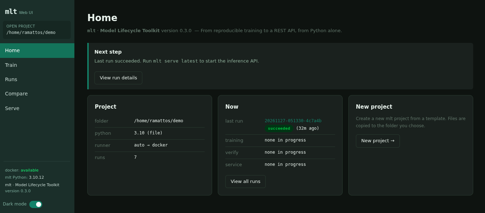

# mlt — Model Lifecycle Toolkit

A tool for data scientists who write only Python code: from reproducible, isolated training to a REST inference API, with a single CLI.

The scientist provides `model.py`, `requirements.txt`, and data. Everything else — environment isolation, artifact storage, run tracking, and serving — is `mlt`'s responsibility.

---

## Quickstart — end to end in 6 steps

### Step 1 — Create a project from the iris template

Scaffolds a new project folder with a working Iris classifier — ready to check and train immediately.

```bash
mlt init ~/demo --template iris
cd ~/demo
```

The iris template ships with `model.py`, `requirements.txt`, `params.yaml`, `schema.yaml`, `.python-version`, and `data/iris.csv`. See [What to provide](#what-to-provide) for the role of each file.

### Step 2 — Validate the contract (no training yet)

Validates that the project contract is correct (model class, dependencies, data) without running any training.

```bash
mlt check .
```

```
  python  3.10  (file)
  data    ~/demo/data

  ✓ requirements.txt found  [requirements.txt]
  ✓ class Model: required methods present  [model.py:4]
  ✓ params.yaml is valid  [params.yaml]
  ✓ data directory found and not empty  [~/demo/data]

ok
```

### Step 3 — Train

Builds an isolated environment and trains the model; the result is an immutable run with model, metrics, and manifest.

```bash
mlt train .
```

```
  python  3.10  (source: .python-version)
  runner  auto → docker
  seed    42  (source: default)

  building environment (may be slow the first time)...
  training...

  run_id  20261125-143000-a1b2c3
  status  succeeded
  accuracy  0.9667

Suggested steps:
  mlt runs show 20261125-143000-a1b2c3
  mlt serve 20261125-143000-a1b2c3
```

> On subsequent runs with the same inputs, `mlt train` returns immediately and prints the existing run ID — no redundant retraining.

Add `--verbose` to print the full `train.log` at the end (pip output, `fit()` prints, etc.); without it, the log is saved to `.mlt/runs/<run_id>/train.log` but not shown.

The run is stored under `<project>/.mlt/runs/`. See [Directory layout](#directory-layout) for what it contains.

### Step 4 — Inspect the run

Lists all recorded runs and inspects the full manifest of the latest one.

```bash
mlt runs list
mlt runs show latest                    # or: mlt runs show 20261125-143000-a1b2c3
```

`runs show` displays identity, inputs (code hash, params, data hash, seed, Python), environment (runner, isolation), and outputs (metrics, model path).

### Step 5 — Serve the model

Loads the model from the run and starts a FastAPI server; prints the URL only after the model is ready.

```bash
mlt serve latest                    # or: mlt serve 20261125-143000-a1b2c3
```

```
  run_id  20261125-143000-a1b2c3
  runner  docker
  starting server...

  url      http://127.0.0.1:8000
  docs     http://127.0.0.1:8000/docs

  curl -s -X POST http://127.0.0.1:8000/predict -H "Content-Type: application/json" -d '{"inputs": [{"sepal_length": 0.0, "sepal_width": 0.0, "petal_length": 0.0, "petal_width": 0.0}]}'

  Ctrl+C to stop
```

> The URL is only printed after `/health` returns 200 — the model is always loaded before you can call it.

The server runs in the foreground and holds the terminal. Open a second terminal for Step 6. Press `Ctrl+C` to stop.

### Step 6 — Predict

Sends a prediction request to the running API and shows the structured response.

```bash
curl -s -X POST http://127.0.0.1:8000/predict \
  -H 'Content-Type: application/json' \
  -d '{"inputs": [{"sepal_length": 5.1, "sepal_width": 3.5, "petal_length": 1.4, "petal_width": 0.2}]}' \
  | python3 -m json.tool
```

```json
{
    "predictions": ["setosa"],
    "run_id": "20261125-143000-a1b2c3"
}
```

Swagger UI with an interactive editor is available at `http://127.0.0.1:8000/docs`.

---

## Prerequisites

| Requirement | Notes |
|-------------|-------|
| Python ≥ 3.10 | Host interpreter used to run `mlt` itself |
| Docker (optional) | Primary isolation mode; without it, `mlt` falls back to venv automatically |
| Network access on first build | Packages are downloaded once; subsequent runs use the cache |

---

## Installation

`mlt` manages isolated environments for your projects, so it should live in its own isolated environment on the host — not inside any project venv.

**Recommended — via pipx (isolated, globally available):**

```bash
pipx install .
```

**Alternative — manual venv (pipx equivalent, without pipx):**

```bash
python3 -m venv ~/.local/share/mlt
~/.local/share/mlt/bin/pip3 install .
# add ~/.local/share/mlt/bin to your PATH (once, in ~/.bashrc or ~/.zshrc)
export PATH="$HOME/.local/share/mlt/bin:$PATH"
```

**Development (editable, includes test deps):**

```bash
python3 -m venv .venv
source .venv/bin/activate
pip3 install -e ".[dev]"
```

Verify:

```bash
mlt --version
# mlt 0.3.0
# python 3.10.12
# docker: available, daemon running        # docker group configured
# docker: available, daemon not responding  # no permission / daemon down
# docker: unavailable                       # docker not installed
```

```bash
mlt --help
# Usage: mlt [OPTIONS] [COMMAND] [ARGS]...
#
#   mlt: from reproducible training to a REST API, from Python alone.
#
# Options:
#   --version  Show version, Python and Docker status, then exit.
#   --help     Show this message and exit.
#
# Commands:
#   check   Validate the project contract without training.
#   diff    Compare two runs and show what changed.
#   init    Create a new mlt project from a template.
#   runs    List and inspect training runs.
#   serve   Start the inference API for a run (foreground; Ctrl+C to stop).
#   train   Train a model and record a run.
#   verify  Re-train from a run's snapshot and verify reproducibility.
```

---

## Scientist's guide

### What to provide

| File | Required | Role |
|------|----------|------|
| `model.py` | yes | one class inheriting from `SklearnModel` or `MLModel` |
| `requirements.txt` | yes | all packages `model.py` imports; pinned versions recommended |
| `data/` | yes | training data folder (or `--data <path>`) |
| `params.yaml` | no | hyperparameters passed as `params` to `fit` |
| `schema.yaml` | no | input feature types and constraints; inferred from training if absent |
| `.python-version` | no | one line, e.g. `3.12`; `requirements.txt` cannot declare Python |

### Choosing a base class

| Situation | Base class | What you implement |
|-----------|------------|--------------------|
| scikit-learn (or any joblib-compatible estimator) | `SklearnModel` | `fit` only (minimum); assign `self.model`. `predict`, `save`, and `load` are provided — override only if needed |
| Any other framework (PyTorch, XGBoost, custom) | `MLModel` | `fit`, `predict`, `save`, `load` |

Start with the template:

```bash
mlt init <folder> --template iris   # scikit-learn example
```

When using `MLModel` directly, you must also implement `save(self, path)` and `load(self, path)`: `path` is a local directory created by `mlt` — write whatever files you need there and read them back in `load`. The `blank` template (planned; see [Planned features](#planned-features)) will provide a commented skeleton for this case.

### Writing `model.py`

```python
from mlt.model.sklearn import SklearnModel   # or: from mlt.model.base import MLModel

class Model(SklearnModel):

    def fit(self, data_dir, params):
        """
        data_dir: pathlib.Path — read-only folder with your training data.
        params:   dict — contents of params.yaml (empty dict if absent).
        self.seed is set by mlt before fit is called.

        Return a dict of metrics (name -> float). They appear in `runs list`
        and are compared by `mlt verify`.
        """
        import pandas as pd
        from sklearn.ensemble import RandomForestClassifier
        from sklearn.model_selection import train_test_split

        df = pd.read_csv(data_dir / "iris.csv")
        X, y = df.drop(columns="species"), df["species"]
        X_tr, X_te, y_tr, y_te = train_test_split(
            X, y, test_size=0.2, random_state=self.seed
        )
        self.model = RandomForestClassifier(
            n_estimators=params.get("n_estimators", 100),
            random_state=self.seed,
        ).fit(X_tr, y_tr)
        return {"accuracy": float(self.model.score(X_te, y_te))}

    def predict(self, inputs):
        """Return one prediction per input record.

        inputs is a list of dicts with feature names as keys::

            predict([{"sepal_length": 5.1, "sepal_width": 3.5,
                      "petal_length": 1.4, "petal_width": 0.2}])
            # returns ["setosa"]

        SklearnModel reorders columns to match training order and calls
        self.model.predict(). Override for custom pre/post-processing.
        """
        return super().predict(inputs)

    def save(self, path):
        """Persist the model to a directory.

        path is a pathlib.Path to a local directory created by mlt.
        SklearnModel serialises self.model to path/model.joblib via joblib.
        Override if your model requires a different serialisation format.
        """
        super().save(path)

    @classmethod
    def load(cls, path):
        """Restore the model from a directory.

        path is a pathlib.Path to the same directory passed to save().
        SklearnModel loads self.model from path/model.joblib via joblib.
        Override if you customised save().
        """
        return super().load(path)
```

### Rules

1. **`fit`** reads from `data_dir` (read-only). Use `tempfile` for temporaries. Everything printed in `fit` goes to `train.log`.
2. **`predict`** receives `list[dict]` with the same column names used in training and returns a `list` of the same length. JSON-serializable.
3. **`self.seed`** is assigned by `mlt` before `fit` runs. Pass it to every estimator and `train_test_split`.
4. **`requirements.txt`** must list everything `model.py` imports. The environment has nothing else.
5. **Data** lives in `<project>/data/` by default, or in the path given by `--data`. It is never copied into the Docker image.
6. **Schema**: if `fit` trains on a named DataFrame, `mlt` infers the schema from `feature_names_in_`. To add type constraints or required fields, write `schema.yaml`.

### `schema.yaml` (optional)

```yaml
features:
  sepal_length:
    type: float
    min: 0.0
  sepal_width:
    type: float
    min: 0.0
  petal_length:
    type: float
    min: 0.0
  petal_width:
    type: float
    min: 0.0
```

Supported types: `int`, `float`, `str`. Optional constraints: `min`, `max`, `allowed`, `required`.

---

## CLI reference

| Command | What it does |
|---------|-------------|
| `mlt --version` | Version, Python, Docker status |
| `mlt init <folder> --template iris` | Create a new project from the iris template |
| `mlt check [folder]` | Validate the contract without training; `--deep` builds the environment and validates inside it |
| `mlt train [folder]` | Train and record a run; flags: `--runner auto\|docker\|venv`, `--seed N`, `--timeout 600`, `--force`, `--verbose` |
| `mlt runs list` | Last 20 runs (run_id, status, duration, metrics, fingerprint); `--all` |
| `mlt runs show <run_id>` | Full run detail; `latest` and unique prefix accepted |
| `mlt diff <a> <b>` | What changed between two runs |
| `mlt verify <run_id>` | Retrain from the run's own snapshot and compare metrics |
| `mlt serve <run_id>` | Start the inference API; `--port 8000`, `--host 127.0.0.1` |
| `mlt ui [folder]` | Open the local Web UI for the project — **experimental** (see below) |

**Run ID shortcuts:** every command that takes a `run_id` also accepts `latest` and any unique prefix (like `git`).

### What `mlt` controls

| File / flag | Effect | Default |
|-------------|--------|---------|
| `--runner` | `auto` (Docker if available, else venv), `docker`, `venv` | `auto` |
| `--seed` / `MLT_SEED` | Random seed; recorded in the manifest | 42 |
| `--python` / `.python-version` | Python version for the isolated environment | interpreter running `mlt` (venv) or `3.12` (Docker) |
| `--timeout` | Training timeout in seconds | 600 |
| `--data` | Data directory | `<project>/data/` |

---

## Inference API

| Endpoint | Description |
|----------|-------------|
| `POST /predict` | `{"inputs": [{"feature": value, …}]}` → `{"predictions": […], "run_id": "…"}` |
| `GET /schema` | Effective input schema for the served run |
| `GET /metadata` | run_id, fingerprint, metrics, schema hash |
| `GET /health` | 200 when the model is loaded |
| `GET /docs` | Swagger UI with interactive example |

Error codes: 400 (malformed JSON), 413 (batch > 1000), 422 (schema violation with field path), 500 (exception in `predict`).

---

## Web UI (experimental)

> **Experimental.** The Web UI has no automated test coverage. It is a visual companion to the CLI — useful for exploration and demos, but not recommended as the primary interface for production workflows. Bugs are possible.

`mlt ui` starts a local web server and opens a browser-based interface for the project. It covers the same operations as the CLI: browsing runs, training, serving, verifying reproducibility, comparing runs, and creating new projects.

```bash
mlt ui .          # open the UI for the current project
mlt ui ~/demo     # open the UI for a specific project
```

The server starts on `http://127.0.0.1:8080` by default (`--port` to change). Press `Ctrl+C` to stop it.



### What the UI covers

| Feature | CLI equivalent |
|---------|---------------|
| Browse runs, run detail, compare | `mlt runs list/show`, `mlt diff` |
| Start, cancel, and monitor training with step-by-step progress | `mlt train` |
| Start and stop the inference service | `mlt serve` |
| Verify reproducibility with live progress | `mlt verify` |
| Create a new project from a template | `mlt init` |

### Known limitations

- **One project per server instance.** `mlt ui` binds to a single project directory at startup; opening a different project requires restarting.
- **One operation at a time.** Only one training job and one verification can run simultaneously via the UI (same constraint as the CLI, enforced explicitly).
- **No automated tests.** The UI is tested manually. Frontend regressions (broken polling, stale state after navigation) may occur.

---

## Reproducibility and traceability

Every run records a **fingerprint** — a hash of code, params, schema, deps, Python version, and seed. If you run `mlt train` with the same inputs, `mlt` returns the existing run instead of retraining.

### `mlt verify <run_id>`

Re-trains the model from scratch using exactly what the run stored — its own `code/` snapshot, params, seed, and Python version — and compares the resulting fingerprint and metrics against the original. Use it to confirm that a run is truly reproducible, independent of any changes made to the project since training.

```bash
mlt verify 20261125-143000-a1b2c3
```

Exit 0 means reproduced; exit 4 means the metrics diverged beyond tolerance. The verification itself is recorded as a new run marked with `verification_of: <original_run_id>` — it appears in `mlt runs list` but is not a training run.

### `mlt diff <a> <b>`

Compares the manifests of two runs and shows only what changed — code hash, params, deps, seed, metrics. Useful for understanding why two runs produced different results.

```bash
mlt diff 20261125-143000-a1b2c3 latest
```

Data traceability is identity-level by default: `mlt` records the hash of each file in the data folder. Without `--snapshot-data` (planned for a future version; see [Planned features](#planned-features)), `verify` refuses if data has changed, pointing you to `diff`.

---

## Directory layout

### Project (`.mlt/`)

Created inside the scientist's project folder. Each training run is stored as a self-contained directory; nothing is shared between projects.

```
<project>/
  .mlt/
    runs/
      <run_id>/
        manifest.json         source of truth: inputs, environment, outputs, status
        model/                artifacts written by model.save() (e.g. joblib file)
        metrics.json          key/value metrics returned by fit()
        train.log             full output of the training process (pip + fit prints)
        code/                 snapshot of the project at training time (no data/)
        params.yaml           effective hyperparameters used in this run
        schema_effective.yaml input schema used for validation and serving
    index.sqlite              SQLite query index — rebuildable from manifests
```

The SQLite index is a cache; the manifest is authoritative. `mlt verify` retrains from `code/` inside the run, never from the project root.

### Host cache (`~/.mlt/`)

Shared across all projects on the machine. Stores isolated environments keyed by a hash of dependencies, Python version, and `mlt` version — so projects with identical requirements reuse the same environment.

```
~/.mlt/
  envs/
    <env_hash>/            isolated venv; hash covers deps, Python version, and mlt version
      bin/python           interpreter used by mlt serve to load the model
      ...
```

> When using the Docker runner, environments are stored as Docker images (`mlt-env:<env_hash>`) in Docker's own image registry, not under `~/.mlt/`.

---

## Planned features

The following flows are designed but not yet implemented:

- `--snapshot-data`: content-addressed data snapshot for full reproducibility without relying on stable files
- `serve --detach`, `mlt ps`, `mlt stop`, `mlt logs`: background serving with process management
- `blank` template: `MLModel` skeleton for non-sklearn frameworks
- `--json` output flag on all commands
- `runs list --status` filter (CLI flag; the Web UI already filters by status)

---

## Running the tests

Requires the development environment active (see [Installation → Development](#installation)). Run from the project root:

```bash
# Lint and format
ruff check src/ tests/
ruff format src/ tests/
```

```bash
# Unit tests — fast loop (~20s, no Docker required)
pytest -m "not slow and not docker"

# Unit + integration tests without Docker (~8 min, builds a real venv)
pytest -m "not docker"

# Integration tests with Docker (~30 min, requires Docker daemon)
pytest -m docker
```
