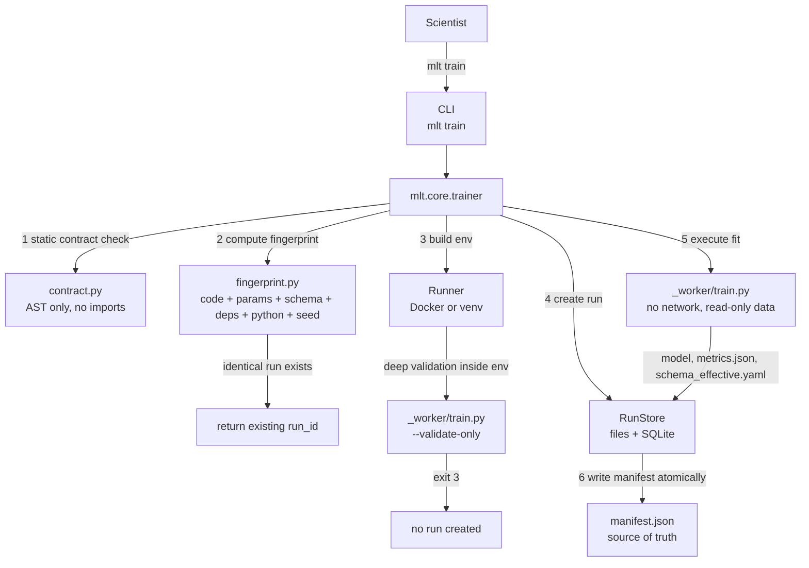
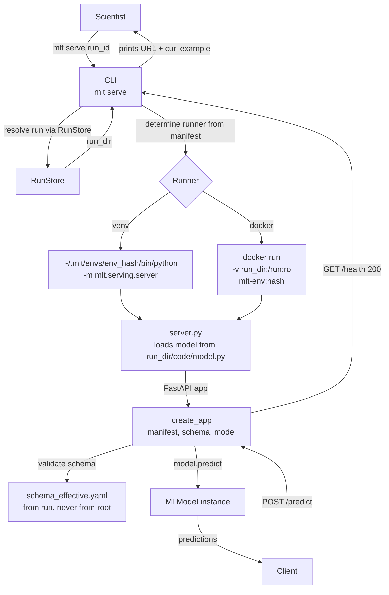
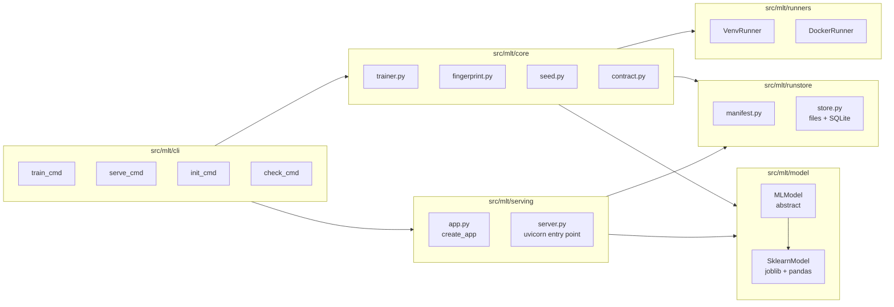
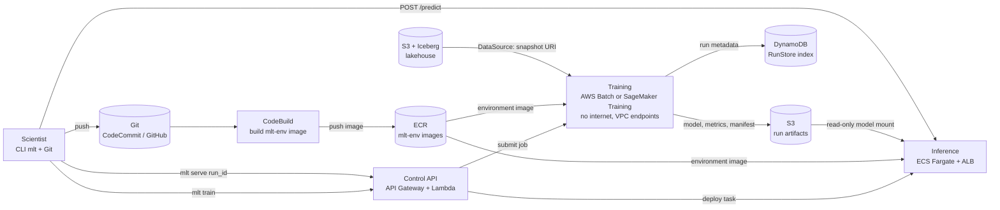

# mlt — Model Lifecycle Toolkit: Architecture

Two views: the local MVP (what is implemented) and production on AWS (design only, not implemented).

---

## Local MVP

The CLI is a thin layer. All logic lives in `mlt.core`, which coordinates three interfaces: `DataSource`, `Runner`, and `RunStore`. Each has a local implementation in the MVP and a clear evolution path toward the cloud.

### Training flow



### Serving flow



### Component map



### Run directory structure

```
<project>/.mlt/runs/<run_id>/
├── manifest.json          source of truth (inputs, fingerprint, environment, outputs, error)
├── model/                 artifacts written by save() — format is the scientist's choice
│   └── model.joblib       (SklearnModel default)
├── metrics.json
├── train.log              stdout + stderr from fit()
├── params.yaml            effective params at training time
├── schema_effective.yaml  declared or inferred; read by the server at serve time
└── code/                  snapshot of the project (no data/, no .mlt/)
    ├── model.py
    └── requirements.txt
```

`verify` retrains from `code/` inside this directory, never from the project root. The run is immutable after `status: succeeded`.

---

## Production on AWS (design only)

The three MVP interfaces (`DataSource`, `Runner`, `RunStore`) map directly to AWS services. The CLI becomes a client of a control API; the scientist's workflow does not change.



### Evolution mapping

| MVP component | AWS equivalent | Notes |
|---------------|---------------|-------|
| `LocalDataSource` | `S3DataSource` with Iceberg snapshot | `--snapshot-data` becomes an immutable S3 path; `verify` always works |
| `VenvRunner` / `DockerRunner` | AWS Batch job or SageMaker Training job | Same `Runner` interface; job definition replaces Dockerfile |
| `RunStore` (files + SQLite) | S3 artifacts + DynamoDB index | Manifest stays the source of truth; DynamoDB replaces SQLite |
| `mlt serve` (foreground subprocess) | ECS Fargate task behind ALB | `serve --detach` maps to a task launch; `ps`/`stop` map to task describe/stop |
| CodeBuild | Triggered on Git push | Builds and pushes `mlt-env:<hash>` to ECR; Docker layer cache = same speed |

**What does not change:** the scientist's contract (`model.py`, `requirements.txt`, `params.yaml`, `schema.yaml`) and the manifest format. A run produced locally and one produced on AWS are identical JSON objects, and `diff`/`verify` work across both.

**Network isolation in production:** training jobs run in a VPC with no internet gateway; S3 and ECR are accessed via VPC endpoints. Same guarantee as `--network none` in the local Docker runner.
