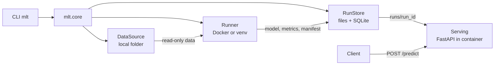
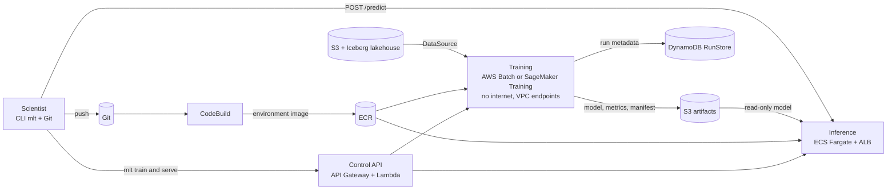

# mlt — Model Lifecycle Toolkit: Design

Specification of the MVP, consolidated from the design decisions. Complements `DECISIONS.md` (which records the why) with the what to build.

## 1. Goal

A tool for data scientists who write only Python code. From reproducible, isolated training to a REST inference API, with artifacts and metrics associated with the execution that generated them.

The scientist provides Python, dependencies, and data. Everything else is the tool's responsibility.

## 2. Principles

- The CLI is a thin layer over `mlt.core`. All logic lives in the core.
- Three interfaces with local implementation in the MVP and a path of evolution: `DataSource`, `Runner`, `RunStore`.
- The run is immutable and self-contained: everything that identifies it is in the manifest.
- Training runs without network, with read-only data.
- Fail early and with a clear message: contract errors are detected before training.
- Do not promise what cannot be guaranteed: reproducibility is identification plus verification, and this is stated.

## 3. Repository structure

```
README.md                  scientist's quickstart (6 steps) and scientist's guide (one page)
DECISIONS.md  AI_USAGE.md  at the root, as requested in the problem statement
CLAUDE.md                  context for Claude Code
pyproject.toml
src/mlt/
  cli/                     commands (thin layer)
  core/                    training, serving, runs, manifest, errors, and exit codes
  model/                   MLModel (core, NO external dependencies) and framework conveniences (sklearn.py)
  runners/                 Runner: docker, venv
  datasources/             DataSource: local
  runstore/                RunStore: files + SQLite
  serving/                 generic FastAPI server
  templates/iris/          scikit-learn example project, with `.python-version`, `params.yaml`, and `.gitignore` (single copy; used by `init` and by tests)
  templates/blank/         MLModel skeleton with TODO, for other frameworks
tests/
docs/
  design.md                this file
  architecture.md          Mermaid diagrams
```

The `model/` core (`MLModel`) must not import anything outside the standard library or bring patterns tied to a framework. Conveniences like `SklearnModel` live in their own modules and import joblib and pandas lazily. This makes evolution to a separate SDK mechanical.

## 4. Scientist's contract

A project folder (recognized by the presence of `model.py`):

| File | Required | Role |
|---|---|---|
| `requirements.txt` | yes | dependencies; pinned versions are recommended (warning if not) |
| `model.py` | yes | exactly one subclass of `MLModel` (or a convenience like `SklearnModel`) |
| `params.yaml` | no | if it exists, becomes the `params` argument of `fit` |
| `schema.yaml` | no | input features; without it, inferred |
| `.python-version` | no | one line, e.g. `3.12`; Python version for training. `requirements.txt` cannot declare it |
| data | external | local folder: `<project>/data/` by default, or `--data <folder>` |

### Scientist's guide (minimum content, part of the README)

One page that tells the scientist what is expected of them:

1. **Choosing the base class:** scikit-learn or compatible, `SklearnModel` (just `fit`, assigning `self.model`); any other framework, `MLModel` (all four methods). `mlt init --template iris` or `--template blank` gives the starting point.
2. **Construction:** the class is instantiated without arguments. The tool assigns `self.seed` before `fit`. Everything that varies comes through `params`.
3. **`fit`:** reads files from `data_dir` (read-only), uses `params` and `self.seed`, and returns only numbers in the metrics. Everything it prints goes to `train.log`. For temporary files, use `tempfile`.
4. **`predict`:** receives a list of dicts with the same column names as during training and returns a list of the same size. Preprocessing must be in `self.model` (e.g., a Pipeline) or in `predict`.
5. **`save` and `load`:** `path` is a local directory created by the tool; the model writes whatever files it wants there. `SklearnModel` already does this with joblib.
6. **`requirements.txt`:** it is everything that exists in the environment. Everything that `model.py` imports must be there, with pinned versions.
7. **Data:** in `<project>/data/`, or indicated by `--data`.
8. **Schema:** inference only works if `fit` trains with a DataFrame with named columns; otherwise, declare `schema.yaml`.
9. **Python:** the version comes from `--python`, from `.python-version` (one line, optional), or from the default; `requirements.txt` does not declare it.
10. **`check` limits:** it validates the contract without training. Errors inside `predict` only appear when serving.

### Minimal example (this is the `model.py` of the `iris` template)

```python
from mlt.model.sklearn import SklearnModel


class Model(SklearnModel):
    def fit(self, data_dir, params):
        import pandas as pd
        from sklearn.ensemble import RandomForestClassifier
        from sklearn.model_selection import train_test_split

        df = pd.read_csv(data_dir / "iris.csv")
        X, y = df.drop(columns="species"), df["species"]
        X_tr, X_te, y_tr, y_te = train_test_split(
            X, y, test_size=0.2, random_state=self.seed
        )
        self.model = RandomForestClassifier(
            n_estimators=params.get("n_estimators", 100),
            max_depth=params.get("max_depth"),
            random_state=self.seed,
        ).fit(X_tr, y_tr)
        return {"accuracy": float(self.model.score(X_te, y_te))}

    def predict(self, inputs):
        # SklearnModel reorders columns to match training order and calls
        # self.model.predict(). Override for custom pre/post-processing.
        return super().predict(inputs)

    def save(self, path):
        # path is a pathlib.Path; SklearnModel saves to path/model.joblib.
        # Override if your model requires a different serialisation format.
        super().save(path)

    @classmethod
    def load(cls, path):
        # path is a pathlib.Path; SklearnModel loads from path/model.joblib.
        # Override if you customised save().
        return super().load(path)
```

### The contract in code (for implementers)

```python
class MLModel(ABC):                             # core, framework-agnostic
    seed: int                                   # assigned by the tool before fit

    @abstractmethod
    def fit(self, data_dir: Path, params: dict) -> dict[str, float]:
        """Trains and returns metrics (name -> number). The model stays in self."""

    @abstractmethod
    def predict(self, inputs: list[dict]) -> list:
        """One prediction per record, in the same order. Free-form, JSON-serializable."""

    @abstractmethod
    def save(self, path: Path) -> None:
        """path: local directory created by the tool."""

    @classmethod
    @abstractmethod
    def load(cls, path: Path) -> "MLModel":
        """path: local directory with what save wrote."""


class SklearnModel(MLModel):                    # optional convenience
    # The scientist only writes fit and assigns self.model.
    # default predict: records -> table (feature order from schema) -> self.model.predict
    # default save/load: joblib, inside the directory
```

The core requires `fit`, `predict`, `save`, and `load`, all abstract, to avoid coupling the tool to one artifact type (a default `predict` based on scikit-learn Pipeline would make PySpark models difficult, for example). `SklearnModel` provides scikit-learn ergonomics without imposing them. A future `SparkModel` only needs to implement `save` and `load` in the native format.

`save` and `load` operate on a local directory. Who transports the package between disk and a remote registry is `RunStore`; the model never talks to the registry. This allows swapping `RunStore` without changing the scientist's contract.

In `SklearnModel`, if `self.model` does not exist or does not have `predict` after `fit`, the run ends as `failed` (code 4) with a clear message. This is the only contract violation found after training, and only occurs in the convenience class.

Evolution rule for the `fit` signature (and, by extension, `save` and `load`): the tool can pass only the parameters the method declares (like pytest fixtures). This would allow, for example, `fit(self, data_uri, params, spark)` in Spark models, or a URI instead of a local directory for very large models, without breaking current ones. Not implemented in the MVP.

`schema.yaml`:

```yaml
features:
  age:    {type: int, min: 0, max: 120}
  income: {type: float, required: true}
  sex:    {type: str, allowed: [F, M]}
```

Interpretation of "only Python code": no infrastructure or server, not no convention. The required items are `requirements.txt` and `model.py`; the YAMLs are optional. The friction of inheriting from `MLModel` is mitigated by `mlt init`, and by the `model/` core having no external dependencies, which keeps the class testable outside the tool.

Inferred schema: from `feature_names_in_` of the trained model (sklearn with DataFrame). Without names, the schema has no structure (free dict) and the tool warns in `check` and in `/schema`.

## 5. CLI

**Clarity for the scientist:** `train` prints at the start what is in effect and where it came from (`python 3.12 (source: .python-version)`, `runner docker`, `seed 42 (source: default)`); `check` shows the same; `init` generates commented `.python-version` and `params.yaml`; the README includes a "what I control" table (file or flag, effect, default).

**Installation:** `pip install .` in a host venv, Python `>=3.10` (declared in `pyproject.toml`). The package brings only `mlt` and its runtime (CLI, YAML, FastAPI, uvicorn); model dependencies come from the project's `requirements.txt`, inside the isolated environment. README prerequisites: Docker running (optional; without it, `--runner venv`) and network on the first build.

| Command | Function |
|---|---|
| `mlt --version` | shows the `mlt` version, the Python running `mlt`, and what was detected (`docker: available` or `unavailable`, daemon running) |
| `mlt init <folder> --template iris` | creates a new project from the iris template (scikit-learn example). Runs from any folder. Refuses an existing non-empty folder (exit 2), without overwriting. Includes a `.gitignore` with `.mlt/` (without `git init`) and prints the next steps (`cd`, `check`, `train`). (`--template blank` and `--force` are P2.) |
| `mlt check [folder]` | validates the contract statically, without training (reads the root); `--deep` builds the environment and validates inside it |
| `mlt train [folder]` | trains and records a run |
| `mlt runs list` / `mlt runs show <run_id>` | lists and details runs (`--json` optional) |
| `mlt diff <a> <b>` | what changed between two runs |
| `mlt verify <run_id>` | retrains and compares; refuses if data changed |
| `mlt serve <run_id>` (or `latest`) | starts the API (`--detach`, `--port`, `--host`) |
| `mlt ps` / `mlt stop <run_id>` / `mlt logs <run_id>` | service management |

Flags for `train`: `--data <folder>` (default `<project>/data/`), `--runner auto|docker|venv`, `--python 3.12` (precedence: flag, then `.python-version`, then default), `--seed N`, `--timeout 600`, `--force`, `--verbose`. (`--snapshot-data` and `--rebuild` are P2.)

`check` is **static**: reads `model.py` without importing it (the scientist's dependencies only exist in the isolated environment, not on the host). It validates: unique subclass, required methods defined, valid `params.yaml` and `schema.yaml`, `requirements.txt` present, and valid seed. Deep validation (import, instantiate, and check the methods) runs inside the environment, without network, in `train` and in `check --deep`.

**`check` details:**
- **Data:** `check` does not look at the `data/` folder directly; it calls `DataSource.check()`. In the MVP (local) it checks that the folder (`<project>/data/` or `--data`) exists and is not empty (error, exit 3). In a future lakehouse it would be a metadata query (table and snapshot resolve, permission exists), without downloading anything. In training, the `DataSource` materializes the data into a local read-only `data_dir`, cached outside the project and outside the image.
- **Inheritance:** the subclass is recognized by name (`MLModel`, `SklearnModel`) and by imports with simple aliases. Indirect inheritance (scientist's own base class) is not resolved: `check` warns "could not confirm, use `--deep`" instead of failing.
- **Output:** one line per check (`ok`, `warning`, `error`), with file and line when possible and the suggested next action. Ends with 0 (no errors) or 3.

Project discovery: `train` and `check` receive the path (default `.`) and require `model.py`. Other commands walk up directories from the current directory until finding `model.py` or `.mlt/`; so `mlt runs list` before the first training responds "no runs yet" (exit 0). Precedence: flag, then `MLT_HOME`, then automatic discovery.

**Behavior of `runs list` and `runs show`:**
- **`list`:** one line per run, from newest to oldest: `run_id`, status (highlighted if `failed`), when, duration, up to 3 metrics (in the order `fit` returned them), and the first 8 characters of the fingerprint. Limited to 20 runs; `--all` shows all. There is no "primary metric" in the contract. `--status succeeded|failed` filters (P2).
- **`show`:** answers "what identifies this run?" in sections: identity (`run_id`, status, dates, duration); inputs (code with commit and whether dirty, params with values, data with hash and file count, seed and origin, Python and origin); environment (runner, isolation, digest); results (all metrics, model path); and, if it failed, the error and the `train.log` path. `--json` prints the full manifest.
- **Run reference:** all commands that receive a `run_id` accept `latest` and a unique prefix of the `run_id`, like in Git. A nonexistent `run_id` exits with 7; an ambiguous prefix exits with 7 and lists the options.

**Behavior of `diff` and `verify`:**
- **`diff <a> <b>`:** does not train; reads the two manifests. Starts by saying whether the fingerprint differs and by which components (`fingerprint: different (params)`). Shows only what differs, grouped: params (`n_estimators: 100 → 300`), code (hash and commit), data, seed, Python and dependencies, environment (runner and isolation), and metrics side by side with the difference. No differences in inputs: "identical inputs". `--json` gives structured output.
- **`verify <run_id>` (minimum version, P1):** answers "if I repeat this run, do I get the same result?". Does not look at the project root: retrains from what the run saved (`code/`, `params.yaml`, `schema.yaml`, seed, and Python), with the same runner as the original (warns if not available; `--runner` overrides). Creates a new run with `verification_of: <run_id>` in the manifest, marked in `runs list`, which keeps runs immutable and the proof auditable.
- **Verdict:** compares the fingerprint (must be equal) and the metrics, one by one, with a fixed relative tolerance of 1e-6. A new or missing metric counts as divergence. Prints original, new, and difference per metric and ends with `reproduced` (exit 0) or `diverged` (exit 4, for use in CI). The model artifact hash does not enter the verdict.
- **Altered data:** without a snapshot, refuses with exit 8 and points to `diff` and `--snapshot-data`. With snapshot (P2), uses the snapshot.
- **What it proves:** that, with the same identified inputs, the code produces equivalent metrics (detects unapplied seed and non-determinism). Does not prove equal data content without a snapshot, nor bit-for-bit reproduction across machines.
- **Outside the minimum version:** `--tolerance`, artifact hash comparison. **If time is short:** cut the command and show the same argument with the integration test "trains twice and compares", already planned in the tests.

## 6. Training flow

1. Validate the contract statically, without importing `model.py` (unique subclass, required methods, `params.yaml`, `schema.yaml`, seed). Error here does not create a run.
2. Calculate input hashes and the fingerprint. If an identical `succeeded` run exists, do not train and point to the run (`--force` repeats).
3. Resolve the environment (Docker image or venv), with lock by hash for concurrent builds. Then, deep validation inside the environment, without network (import and instantiate the class and check the methods). Error here also exits with code 3 and does not create a run.
4. Create the run (`status: running`, partial manifest, row in the index).
5. Execute `fit` without network, with read-only `data_dir`, injected seed, with timeout.
6. Save model, `metrics.json`, effective `params.yaml` and `schema.yaml`, `code/`, and `train.log`; write the final manifest atomically; update the index.

**`train` behavior in the CLI:**
- **Output:** shows the steps (environment, validation, training) and duration. The final summary includes `run_id`, status, metrics, and the next action (`mlt runs show <run_id>`, `mlt serve <run_id>`). The `fit` log goes to `train.log`; with `--verbose` it also appears in the terminal.
- **Slow build:** the first time, prints "building image (first time, may take a few minutes)"; with `--verbose`, shows the build log.
- **Identical run:** does not train, points to the existing run, and exits with 0. `--force` creates a new run.
- **Ctrl+C:** stops the container, marks the run as `failed` with `error: interrupted`, and exits with 130. The run remains consistent even without reconciliation (P2).
- **Build failure** (e.g., nonexistent dependency): exit 6, without creating a run, with the final portion of the `pip` log in the message.

## 7. Environment and isolation

- **Docker (primary):** image `mlt-env:<hash>`, with hash of normalized `requirements.txt`, Python version, and `mlt` version. Base `python:<version>-slim`, with the version coming from `--python`, `.python-version`, or the default `3.12`. The build has network; training does not.
- **venv (alternative):** Python that runs `mlt` (see below), cache in `~/.mlt/envs/<hash>`. Does not isolate network or system; the manifest records the isolation level.
- **venv Python:** it is the interpreter that runs `mlt` (`sys.executable`), created with `sys.executable -m venv`, without searching for other versions in `PATH`. If `--python` or `.python-version` request another version, exits with 6 explaining: use Docker or install `mlt` in a venv with that version. Without a declaration, uses the `mlt` interpreter. Looking for other Pythons on the system is future work.
- **Declared version:** the Python major.minor version enters the `deps` component of the fingerprint. The manifest records the full version (`3.12.4`) in `environment` and the requested version with its origin (`flag`, `file`, or `default`).
- **Runner outside the fingerprint:** the runner goes in `environment` (informational), and `diff` shows the difference. The same project, trained in Docker and in venv with the same Python, has the same fingerprint, and `verify` can compare the two.
- **Without Docker:** `--runner auto` falls back to venv and warns that isolation is lower (`isolation: none` in the manifest). Explicit `--runner docker` without Docker exits with 6, without creating a run. `serve`, `ps`, `stop`, and `logs` use the PID instead of the container.
- After the build, `pip freeze` becomes the lock in the manifest.
- `mlt` is installed in the same environment as the scientist's dependencies. Version conflicts appear as resolver errors. Isolating the runtime is future work.
- The host environment is not inherited by the container; the seed is passed explicitly.
- **How `mlt` enters the image:** the runner copies the installed `mlt` package (only the training/serving runtime) to the build context and installs it in the image. In editable installation (`pip install -e`), the current source code is copied. The `mlt` version does not change during development, so the environment hash uses the version **and** a hash of the `mlt` source code; `--rebuild` forces reconstruction.
- **Network:** the build needs network access once (install packages and download the base). After that, the cache allows offline training; the README says so.
- **Container mounts:** project and `data/` read-only; run output directory writable; `tmpfs` for temporaries; no network during training; user is not root.

## 8. Data

`DataSource` interface. In the MVP, local folder mounted as a read-only volume; nothing is copied to the image.

Traceability in levels:

| Level | Guarantees | When |
|---|---|---|
| Identify | same or different data between runs; which files changed (hash per file and aggregate) | always |
| Verify | `mlt verify` refuses to retrain if data changed | always |
| Freeze | recoverable content, in `store/<hash>/` | `--snapshot-data` |
| Lakehouse | immutable snapshot with time travel | future work |

Without freezing, the guarantee is of identity, not content. Hashing large data is slow; shortcut by mtime and size, documented.

## 9. Run and manifest

`<project>/.mlt/` contains `runs/<run_id>/`, `store/`, and `index.sqlite`. Reusable caches live in `~/.mlt/`.

`run_id`: `YYYYMMDD-HHMMSS-<6 random hex>`, with exclusive directory creation.

Run contents: `model/` (directory created by `save`), `metrics.json`, `manifest.json`, effective `params.yaml` and `schema.yaml`, `code/` (copy of the project without `data/` and without `.mlt/`), `train.log`. This makes the run self-contained: `verify` retrains from `code/`, and a future registry receives the entire folder.

```json
{
  "manifest_version": 1,
  "run_id": "20261123-214900-a1b2c3",
  "status": "succeeded",
  "created_at": "...", "finished_at": "...", "duration_s": 42.1,
  "inputs": {
    "code":   {"hash": "...", "git_commit": "...", "dirty": false},
    "params": {"hash": "...", "values": {"n_estimators": 100}},
    "schema": {"hash": "...", "source": "declared"},
    "python": {"requested": "3.12", "source": "default"},
    "data":   {"hash": "...", "source": "local", "files": {"iris.csv": "..."},
               "snapshot": null, "frozen": false},
    "deps":   {"hash": "...", "lock": ["scikit-learn==1.5.2"]},
    "seed": 42, "seed_source": "default"
  },
  "fingerprint": "...",
  "environment": {"runner": "docker", "env_hash": "...", "python": "3.12.4", "isolation": "no-network"},   // venv: "none"
  "outputs": {
    "metrics": {"accuracy": 0.97},
    "schema": {"hash": "...", "source": "inferred"},
    "artifacts": {"model/model.joblib": "..."}
  },
  "error": null,
  "verification_of": null   // run_id, in runs created by verify
}
```

- The fingerprint is calculated only over `inputs`.
- The code hash ignores `.mlt/`, `.git/`, `__pycache__/`, and data.
- `status: failed` fills `error`; `train.log` is preserved.

**RunStore:** SQLite is only a query index (identity, fingerprint and components, environment, metrics, paths), in WAL mode. The manifest is the source of truth and the index is rebuildable. Runs stuck in `running` without a live process become `failed` (`interrupted`) during reconciliation in `runs list`.

**Root is input, run is record:** training copies `params.yaml` and `schema.yaml` to the run. `serve`, `verify`, and `diff` read from the run; `check` reads from the root.

**Registry readiness:** the run is a self-contained package, and serving always obtains it via `RunStore`, never reading `runs/` directly.

## 10. Seed

Precedence: `--seed`, then `MLT_SEED`, then 42. The tool fixes `random`, `numpy`, and `PYTHONHASHSEED` and injects `self.seed`. Effective value and origin (`cli`, `env`, `default`) go in `inputs`. An invalid value is a contract error.

## 11. Inference API

| Endpoint | Contract |
|---|---|
| `POST /predict` | input `{"inputs": [records]}`; output `{"predictions": [...], "run_id": "..."}`, one prediction per record, in the same order, free-form and JSON-serializable; all-or-nothing validation |
| `GET /schema` | effective schema of the run (YAML and JSON Schema) |
| `GET /metadata` | run_id, fingerprint, created_at, manifest_version, metrics, schema hash |
| `GET /health` | 200 only with the model loaded |

Errors from `/predict`: 422 (index and field of invalid record), 400 (malformed JSON or empty `inputs`), 413 (batch above limit, default 1000), 500 (error in `predict`, no stack trace in response), 503 (model not loaded).

## 12. Serving

- One service serves one run. `latest` resolves to the concrete `run_id` on startup.
- Only serves `succeeded` runs. Already active: reports the URL and exits with 0.
- Image: training environment plus the generic server; model mounted read-only.
- Listens on 127.0.0.1 by default. Docker: container `mlt-<run_id>` with labels; venv: process with PID file. State comes from Docker or the PID, not from SQLite.
- Foreground by default. `--detach` only returns after `/health` returns 200, with timeout.

**`serve` behavior in the CLI:**
- **Output:** only after the model is loaded and `/health` returns 200, prints the URL, the concrete `run_id`, the `/docs` path, and a `curl` example already filled with a record generated from the run's schema. This way `/predict` never responds 503 immediately after the notice.
- **Port:** default 8000. If busy, exits with 6 (environment) and suggests `--port`; does not pick another port on its own, so the printed URL is predictable.
- **`/docs`:** FastAPI generates it; it is kept and cited in the README. The OpenAPI reflects the run's schema, so the example is realistic.
- **Schema:** the server reads `schema.yaml` from the run, never from the root, so `/schema` and validation follow the served model.
- **Readable errors:** 422 indicates index and field (e.g., `inputs[0].petal_width: required field`); the API test exercises this with Iris.

## 13. Exit codes

| Code | Meaning |
|---|---|
| 0 | success (including empty listings) |
| 1 | unexpected error |
| 2 | incorrect CLI usage |
| 3 | contract error (does not create a run) |
| 4 | execution failure (creates a `failed` run; also `serve` when the model does not load, and `verify` that diverges) |
| 5 | timeout (`train`; `serve --detach`) |
| 6 | environment unavailable (Docker absent, build failed, busy port) |
| 7 | not found (project, run, or service) |
| 8 | operation refused by state (`serve` of non-`succeeded` run; `verify` with altered data) |
| 130 | interrupted by Ctrl+C (`train` leaves the run `failed`, `interrupted`) |

Enumeration in `mlt.core`; the CLI only translates exceptions to codes. Errors go to `stderr`, results to `stdout` (`train` prints the `run_id`). Each message says what failed, where, and what to do.

## 14. Demo

Iris (150 samples, 4 features, 3 classes), exported to `data/iris.csv` with snake_case columns (`sepal_length`, `sepal_width`, `petal_length`, `petal_width`). RandomForest with `n_estimators` and `max_depth` in `params.yaml`. Docker as the primary mode, venv also working. The template inherits from `SklearnModel`. It implements all four methods (`fit`, `predict`, `save`, `load`), with `predict`, `save`, and `load` delegating to `super()` and documented with docstrings and examples — so scientists understand what each method does and when to override.

## 15. Tests

| Flow | What it verifies | Type | Environment |
|---|---|---|---|
| Invalid contract | no subclass, multiple, `fit` without metrics, invalid seed: clear error and no run | unit | local |
| End-to-end training | run with model, metrics.json, and complete manifest | integration | venv and Docker |
| Reproducibility | same input and seed: same fingerprint, equivalent metrics, `verify` passes | integration | venv and Docker |
| Only params.yaml changed | new run, different fingerprint, environment reused | integration | venv and Docker |
| Altered data | `verify` refuses; `diff` points to data differences | integration | venv |
| Inference API | order, 422/400/413, `/schema`, `/metadata`, `/health` | integration | TestClient |
| Failures | exception in `fit` and timeout produce `failed` run with `error` and log | integration | venv and Docker |
| Isolation | Docker training does not open a network connection | end-to-end | Docker |
| `check --deep` | contract error inside the environment: exit 3, no run | integration | venv |
| Without Docker | `auto` falls back to venv with warning; `--runner docker` exits with 6 without run | integration | venv, Docker simulated absent |

Tests with Docker are marked (`docker`) and skipped if Docker does not exist. Tests verify exit codes, not just messages.

## 16. Build order

1. Package skeleton, `MLModel`, contract validation, errors, and exit codes.
2. venv training: local `DataSource`, manifest, `RunStore` (files and SQLite), fingerprint, seed.
3. CLI: `init` (`iris` and `blank` templates), `check`, `train`, `runs list/show`, `diff`, `verify`.
4. Docker runner (build with cache, training without network) and isolation tests.
5. Serving: FastAPI server and `serve` (P0); `ps`, `stop`, and `logs` (P2).
6. Failures, timeout, concurrency, and interrupted run reconciliation.
7. README (with the scientist's guide), `docs/architecture.md`, review of `DECISIONS.md` and `AI_USAGE.md`.

Each step ends with passing tests and a commit. Record the time spent per step (input for `DECISIONS.md`).

### Priorities (if time is tight, cut from bottom to top)

- **P0 (without this there is no delivery):** contract and validation, training (Docker and venv), manifest and `RunStore`, `runs list/show`, `serve` with `/predict`, critical flow tests, README, and documents.
- **P1:** `check` (static and `--deep`), `init` with `iris` template, `verify`, `diff`.
- **P2 (cut first):** `--snapshot-data`, `serve --detach`, `ps`, `stop`, `logs`, `blank` template, `--json`, `runs list --status` (CLI flag). The flows for each are closed below. (Interrupted run reconciliation was implemented in `core/reconcile.py`; it runs on `mlt runs list`, `mlt runs show`, and `mlt ui` startup.)

What is cut goes into `DECISIONS.md` as "not done due to time constraints".

### Delivery checklist

Git repository accessible; README with end-to-end example; `DECISIONS.md`; `AI_USAGE.md`; passing tests; architecture diagram (AWS); delivery message with link, date, and time of the presentation.

### P2 feature flows (contract closed, implementation only if time permits)

- **`--snapshot-data`:** copies the data to `.mlt/store/<hash>/`, content-addressed (hardlink or reflink when possible), and records `frozen: true` in the manifest. Before copying, prints the size. If the hash already exists in the store, reuses without copying; a training run without the flag whose data is already in the store also becomes `frozen: true`. `verify` uses the snapshot when the root data has changed. No automatic store cleanup (cleanup is out of scope, stated in the README).
- **`ps`, `stop`, `logs`:** `ps` lists the services of the current project (`run_id`, runner, URL, state, uptime), reading Docker labels or PID files in `.mlt/serving/`. `stop <run_id>` stops the service and exits with 0; nonexistent service exits with 7. `logs <run_id>` accepts `--tail N` (default 100) and `-f`.
- **`serve --detach`:** is P2, together with `ps`, `stop`, and `logs`, because without `stop` a background service would have no way to be stopped. P0 is the foreground, stopped with Ctrl+C.
- **Interrupted run reconciliation:** a `running` run holds a file lock (`flock`) while the process lives; without an active lock, the run becomes `failed` (`interrupted`). Runs lazily, in `runs list`, `runs show`, and at the start of `train`. If cut: Ctrl+C already leaves the run consistent, but `kill -9` leaves the run as `running` forever, and the README says so.
- **`blank` template:** `model.py` with the four `MLModel` methods, comments, and the marker `# TODO(mlt)`, without data. `fit` raises `NotImplementedError("implement fit")`, and `check` warns "unedited template" while the marker exists.
- **`--json`:** applies to `runs list`, `runs show`, `diff`, and `verify`. Writes only JSON to stdout, without colors or messages; errors continue to stderr and exit codes do not change.
- **`runs list --status`:** simple filter by `succeeded` or `failed`.
- **`init --force`:** will not be implemented; left as future work.

## 17. Out of scope and evolution

Out of scope: authentication, data versioning, rollback and A/B, monitoring and drift, GPU, distributed training, CPU and memory limits, old run cleanup, API route versioning, data statistics in the manifest. (Local Web UI delivered as v0.3.0.)

Evolution, in order:

1. Isolate the `mlt` runtime from the scientist's environment (dependency-free SDK plus worker process).
2. Remote `DataSource` (S3 and lakehouse, with snapshot).
3. CLI as a client of a control API, with `Runner` on AWS Batch or SageMaker Training.
4. `RunStore` on S3 and DynamoDB and, later, run and model registry with aliases and promotion.
5. Optional output block in `schema.yaml` and `predict_proba`.
6. Reduce adoption friction: accept a scikit-learn estimator or a simple training function through an adapter, without requiring `MLModel` inheritance.
7. PySpark support: `SparkModel` with native `save` and `load`, `fit` with named-parameter injection, a cluster `Runner` (EMR or Databricks), and a `DataSource` that provides a URI instead of a local path. The current `fit(data_dir, params)` assumes data in a local folder; this is a known MVP limit.

## 18. Diagrams

Local MVP:



Production on AWS (design, not implemented):



*See `docs/architecture.md` for detailed component diagrams, the full training and serving flows, and the MVP → AWS evolution mapping.*
