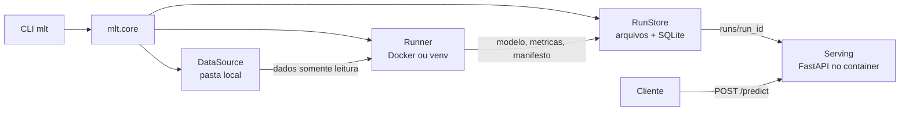
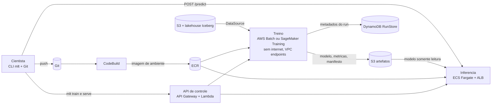

# Design do mlt

Especificação do MVP, consolidada a partir das decisões de design. Complementa o `DECISIONS.md` (que registra o porquê) com o quê construir.

## 1. Objetivo

Uma ferramenta para cientistas de dados que escrevem apenas código Python. Do treino reprodutível e isolado até uma API REST de inferência, com artefatos e métricas associados à execução que os gerou.

O cientista fornece Python, dependências e dados. Todo o resto é responsabilidade da ferramenta.

## 2. Princípios

- A CLI é uma camada fina sobre `mlt.core`. Toda a lógica vive no núcleo.
- Três interfaces com implementação local no MVP e caminho de evolução: `DataSource`, `Runner`, `RunStore`.
- O run é imutável e autocontido: tudo que o identifica está no manifesto.
- O treino roda sem rede, com dados somente leitura.
- Falhar cedo e com mensagem clara: erro de contrato é detectado antes do treino.
- Não prometer o que não se garante: reprodutibilidade é identificação mais verificação, e isso é dito.

## 3. Estrutura do repositório

```
README.md                  quickstart do cientista (6 passos) e guia do cientista (uma página)
DECISIONS.md  AI_USAGE.md  na raiz, como pedido no enunciado
CLAUDE.md                  contexto para o Claude Code
pyproject.toml
src/mlt/
  cli/                     comandos (camada fina)
  core/                    treino, serving, runs, manifesto, erros e códigos de saída
  model/                   MLModel (núcleo, SEM dependências externas) e conveniências por framework (sklearn.py)
  runners/                 Runner: docker, venv
  datasources/             DataSource: local
  runstore/                RunStore: arquivos + SQLite
  serving/                 servidor FastAPI genérico
  templates/iris/          projeto exemplo scikit-learn, com `.python-version`, `params.yaml` e `.gitignore` (única cópia; usado por `init` e pelos testes)
  templates/blank/         esqueleto de MLModel com TODO, para outros frameworks
tests/
docs/
  design.md                este arquivo
  architecture.md          diagramas Mermaid
```

O núcleo de `model/` (`MLModel`) não pode importar nada fora da biblioteca padrão nem trazer padrões ligados a um framework. Conveniências como `SklearnModel` ficam em módulos próprios e importam joblib e pandas de forma preguiçosa. Isso deixa a evolução para um SDK separado mecânica.

## 4. Contrato do cientista

Uma pasta de projeto (reconhecida pela presença de `model.py`):

| Arquivo | Obrigatório | Papel |
|---|---|---|
| `requirements.txt` | sim | dependências; versões fixadas são recomendadas (aviso se não) |
| `model.py` | sim | exatamente uma subclasse de `MLModel` (ou de uma conveniência, como `SklearnModel`) |
| `params.yaml` | não | se existir, vira o argumento `params` do `fit` |
| `schema.yaml` | não | features de entrada; sem ele, é inferido |
| `.python-version` | não | uma linha, por exemplo `3.12`; versão do Python do treino. O `requirements.txt` não consegue declará-la |
| dados | externos | pasta local: `<projeto>/data/` por padrão, ou `--data <pasta>` |

### Guia do cientista (conteúdo mínimo, parte do README)

Uma página que diz ao cientista o que se espera dele:

1. **Escolha da classe base:** scikit-learn ou compatível, `SklearnModel` (só o `fit`, atribuindo `self.model`); qualquer outro framework, `MLModel` (os quatro métodos). `mlt init --template iris` ou `--template blank` dá o ponto de partida.
2. **Construção:** a classe é instanciada sem argumentos. A ferramenta atribui `self.seed` antes do `fit`. Tudo que varia vem por `params`.
3. **`fit`:** lê os arquivos de `data_dir` (somente leitura), usa `params` e `self.seed`, e devolve só números nas métricas. Tudo que ele imprime vai para o `train.log`. Para arquivos temporários, use o `tempfile`.
4. **`predict`:** recebe uma lista de dicts com os mesmos nomes de coluna do treino e devolve uma lista do mesmo tamanho. O pré-processamento precisa estar no `self.model` (por exemplo, um Pipeline) ou no `predict`.
5. **`save` e `load`:** o `path` é um diretório local criado pela ferramenta; o modelo escreve nele os arquivos que quiser. A `SklearnModel` já faz isso com joblib.
6. **`requirements.txt`:** é tudo o que existe no ambiente. Tudo que o `model.py` importa precisa estar lá, com versão fixada.
7. **Dados:** em `<projeto>/data/`, ou indicados por `--data`.
8. **Schema:** a inferência só funciona se o `fit` treinar com um DataFrame de colunas nomeadas; senão, declare o `schema.yaml`.
9. **Python:** a versão vem de `--python`, do `.python-version` (uma linha, opcional) ou do padrão; o `requirements.txt` não a declara.
10. **Limites do `check`:** ele valida o contrato sem treinar. Erros dentro do `predict` só aparecem ao servir.

### Exemplo mínimo (é o `model.py` do template `iris`)

```python
import pandas as pd
from sklearn.ensemble import RandomForestClassifier
from sklearn.model_selection import train_test_split
from mlt.model.sklearn import SklearnModel


class Model(SklearnModel):
    def fit(self, data_dir, params):
        df = pd.read_csv(data_dir / "iris.csv")
        X, y = df.drop(columns="species"), df["species"]
        X_tr, X_te, y_tr, y_te = train_test_split(
            X, y, test_size=0.2, random_state=self.seed
        )
        self.model = RandomForestClassifier(
            n_estimators=params.get("n_estimators", 100),
            max_depth=params.get("max_depth"),
            random_state=self.seed,
        ).fit(X_tr, y_tr)
        return {"accuracy": float(self.model.score(X_te, y_te))}
```

### O contrato em código (para quem implementa)

```python
class MLModel(ABC):                             # núcleo, agnóstico de framework
    seed: int                                   # atribuída pela ferramenta antes do fit

    @abstractmethod
    def fit(self, data_dir: Path, params: dict) -> dict[str, float]:
        """Treina e devolve métricas (nome -> número). O modelo fica em self."""

    @abstractmethod
    def predict(self, inputs: list[dict]) -> list:
        """Uma predição por registro, na mesma ordem. Forma livre, serializável em JSON."""

    @abstractmethod
    def save(self, path: Path) -> None:
        """path: diretório local criado pela ferramenta."""

    @classmethod
    @abstractmethod
    def load(cls, path: Path) -> "MLModel":
        """path: diretório local com o que o save escreveu."""


class SklearnModel(MLModel):                    # conveniência opcional
    # O cientista só escreve o fit e atribui self.model.
    # predict padrão: registros -> tabela (ordem das features do schema) -> self.model.predict
    # save/load padrão: joblib, dentro do diretório
```

O núcleo exige `fit`, `predict`, `save` e `load`, todos abstratos, para não acoplar a ferramenta a um tipo de artefato (um `predict` padrão baseado em Pipeline do scikit-learn dificultaria, por exemplo, modelos PySpark). A `SklearnModel` dá a ergonomia do scikit-learn sem impô-la. Uma `SparkModel` futura só precisa implementar `save` e `load` no formato nativo.

`save` e `load` operam sobre um diretório local. Quem transporta o pacote entre o disco e um registry remoto é o `RunStore`; o modelo nunca fala com o registry. Isso permite trocar o `RunStore` sem mudar o contrato do cientista.

Na `SklearnModel`, se `self.model` não existir ou não tiver `predict` depois do `fit`, o run termina como `failed` (código 4) com mensagem clara. É a única violação de contrato achada após o treino, e só ocorre na classe de conveniência.

Regra de evolução da assinatura do `fit` (e, por extensão, de `save` e `load`): a ferramenta pode passar apenas os parâmetros que o método declara (como as fixtures do pytest). Isso permitiria, por exemplo, `fit(self, data_uri, params, spark)` em modelos Spark, ou uma URI em vez de um diretório local para modelos muito grandes, sem quebrar os atuais. Não é implementado no MVP.

`schema.yaml`:

```yaml
features:
  idade: {type: int, min: 0, max: 120}
  renda: {type: float, required: true}
  sexo:  {type: str, allowed: [F, M]}
```

Interpretação de "somente código Python": sem infraestrutura nem servidor, e não sem convenção. O obrigatório é `requirements.txt` e `model.py`; os YAMLs são opcionais. O atrito de herdar de `MLModel` é mitigado pelo `mlt init`, e por o núcleo de `model/` não ter dependências externas, o que mantém a classe testável fora da ferramenta.

Schema inferido: de `feature_names_in_` do modelo treinado (sklearn com DataFrame). Sem nomes, o schema fica sem estrutura (dict livre) e a ferramenta avisa no `check` e no `/schema`.

## 5. CLI

**Clareza para o cientista:** o `train` imprime no início o que está valendo e de onde veio (`python 3.12 (origem: .python-version)`, `runner docker`, `seed 42 (origem: padrão)`); o `check` mostra o mesmo; o `init` gera `.python-version` e `params.yaml` comentados; o README traz uma tabela "o que eu controlo" (arquivo ou flag, efeito, padrão).

**Instalação:** `pip install .` em um venv do host, Python `>=3.10` (declarado no `pyproject.toml`). O pacote traz só o `mlt` e seu runtime (CLI, YAML, FastAPI, uvicorn); as dependências do modelo vêm do `requirements.txt` do projeto, dentro do ambiente isolado. Pré-requisitos do README: Docker em execução (opcional; sem ele, `--runner venv`) e rede no primeiro build.

| Comando | Função |
|---|---|
| `mlt --version` | mostra a versão do `mlt`, o Python que executa o `mlt` e o que foi detectado (`docker: disponível` ou `indisponível`, daemon em execução) |
| `mlt init <pasta> --template iris` ou `--template blank` | cria um projeto novo a partir do template (`iris`: exemplo scikit-learn; `blank`: esqueleto de `MLModel` com TODO, para outros frameworks). Roda de qualquer pasta. Recusa pasta existente e não vazia (saída 2), sem sobrescrever. Inclui um `.gitignore` com `.mlt/` (sem `git init`) e imprime os próximos passos (`cd`, `check`, `train`). `--force` para pasta existente é P2 |
| `mlt check [pasta]` | valida o contrato de forma estática, sem treinar (lê a raiz); `--deep` constrói o ambiente e valida dentro dele |
| `mlt train [pasta]` | treina e grava um run |
| `mlt runs list` / `mlt runs show <run_id>` | lista e detalha runs (`--json` opcional) |
| `mlt diff <a> <b>` | o que mudou entre dois runs |
| `mlt verify <run_id>` | retreina e compara; recusa se os dados mudaram |
| `mlt serve <run_id>` (ou `latest`) | sobe a API (`--detach`, `--port`, `--host`) |
| `mlt ps` / `mlt stop <run_id>` / `mlt logs <run_id>` | gerência dos serviços |

Flags de `train`: `--data <pasta>` (padrão `<projeto>/data/`), `--runner auto|docker|venv`, `--python 3.12` (precedência: flag, depois `.python-version`, depois o padrão), `--seed N`, `--timeout 600`, `--snapshot-data`, `--rebuild`, `--force`, `--verbose`.

O `check` é **estático**: lê o `model.py` sem importá-lo (as dependências do cientista só existem no ambiente isolado, não no host). Ele valida: subclasse única, métodos obrigatórios definidos, `params.yaml` e `schema.yaml` válidos, `requirements.txt` presente e seed válida. A validação profunda (importar, instanciar e conferir os métodos) roda dentro do ambiente, sem rede, no `train` e no `check --deep`.

**Detalhes do `check`:**
- **Dados:** o `check` não olha a pasta `data/` diretamente; chama `DataSource.check()`. No MVP (local) confere que a pasta (`<projeto>/data/` ou `--data`) existe e não está vazia (erro, saída 3). Num lakehouse futuro seria uma consulta de metadados (tabela e snapshot resolvem, há permissão), sem baixar nada. No treino, o `DataSource` materializa os dados em um `data_dir` local somente leitura, em cache fora do projeto e fora da imagem.
- **Herança:** a subclasse é reconhecida pelo nome (`MLModel`, `SklearnModel`) e por imports com alias simples. Herança indireta (classe base do próprio cientista) não é resolvida: o `check` avisa "não foi possível confirmar, use `--deep`" em vez de falhar.
- **Saída:** uma linha por verificação (`ok`, `aviso`, `erro`), com arquivo e linha quando possível e a próxima ação sugerida. Termina com 0 (sem erros) ou 3.

Descoberta do projeto: `train` e `check` recebem o caminho (padrão `.`) e exigem `model.py`. Os demais comandos sobem diretórios a partir do diretório atual até achar `model.py` ou `.mlt/`; assim `mlt runs list` antes do primeiro treino responde "nenhum run ainda" (saída 0). Precedência: flag, depois `MLT_HOME`, depois descoberta automática.

**Comportamento de `runs list` e `runs show`:**
- **`list`:** uma linha por run, do mais recente ao mais antigo: `run_id`, status (destacado se `failed`), quando, duração, até 3 métricas (na ordem em que o `fit` as devolveu) e os 8 primeiros caracteres do fingerprint. Limita a 20 runs; `--all` mostra todos. Não há "métrica principal" no contrato. `--status succeeded|failed` filtra (P2).
- **`show`:** responde "o que identifica este run?" em seções: identidade (`run_id`, status, datas, duração); entradas (código com commit e se estava sujo, params com valores, dados com hash e número de arquivos, seed e origem, Python e origem); ambiente (runner, isolamento, digest); resultados (todas as métricas, caminho do modelo); e, se falhou, o erro e o caminho do `train.log`. `--json` imprime o manifesto inteiro.
- **Referência a runs:** todos os comandos que recebem `run_id` aceitam `latest` e um prefixo único do `run_id`, como no Git. `run_id` inexistente sai com 7; prefixo ambíguo sai com 7 e lista as opções.

**Comportamento de `diff` e `verify`:**
- **`diff <a> <b>`:** não treina; lê os dois manifestos. Começa dizendo se o fingerprint difere e por quais componentes (`fingerprint: diferente (params)`). Mostra só o que difere, agrupado: params (`n_estimators: 100 → 300`), código (hash e commit), dados, seed, Python e dependências, ambiente (runner e isolamento) e métricas lado a lado com a diferença. Sem diferenças nas entradas: "entradas idênticas". `--json` dá a saída estruturada.
- **`verify <run_id>` (versão mínima, P1):** responde "se eu repetir este run, obtenho o mesmo resultado?". Não olha a raiz do projeto: retreina a partir do que o run guardou (`code/`, `params.yaml`, `schema.yaml`, seed e Python), com o mesmo runner do original (avisa se não estiver disponível; `--runner` troca). Cria um run novo com `verification_of: <run_id>` no manifesto, marcado no `runs list`, o que mantém os runs imutáveis e a prova auditável.
- **Veredito:** compara o fingerprint (deve ser igual) e as métricas, uma a uma, com tolerância relativa fixa de 1e-6. Métrica nova ou ausente conta como divergência. Imprime original, nova e diferença por métrica e termina com `reproduzido` (saída 0) ou `divergiu` (saída 4, para uso em CI). O hash do artefato do modelo não entra no veredito.
- **Dados alterados:** sem snapshot, recusa com saída 8 e aponta o `diff` e o `--snapshot-data`. Com snapshot (P2), usa o snapshot.
- **O que prova:** que, com as mesmas entradas identificadas, o código produz métricas equivalentes (detecta seed não aplicada e não determinismo). Não prova conteúdo igual dos dados sem snapshot, nem reprodução bit a bit entre máquinas.
- **Fora da versão mínima:** `--tolerance`, comparação do hash do artefato. **Se faltar tempo:** cortar o comando e mostrar o mesmo argumento com o teste de integração "treina duas vezes e compara", já previsto nos testes.

## 6. Fluxo de treino

1. Validar o contrato de forma estática, sem importar o `model.py` (subclasse única, métodos obrigatórios, `params.yaml`, `schema.yaml`, seed). Erro aqui não cria run.
2. Calcular os hashes de entrada e o fingerprint. Se existir run `succeeded` idêntico, não treina e aponta o run (`--force` repete).
3. Resolver o ambiente (imagem Docker ou venv), com lock por hash para builds concorrentes. Em seguida, a validação profunda dentro do ambiente, sem rede (importa e instancia a classe e confere os métodos). Erro aqui também sai com código 3 e não cria run.
4. Criar o run (`status: running`, manifesto parcial, linha no índice).
5. Executar o `fit` sem rede, com `data_dir` somente leitura, seed injetada, com timeout.
6. Salvar modelo, `metrics.json`, `params.yaml` e `schema.yaml` efetivos, `code/` e `train.log`; gravar o manifesto final de forma atômica; atualizar o índice.

**Comportamento do `train` na CLI:**
- **Saída:** mostra as etapas (ambiente, validação, treino) e a duração. O resumo final traz `run_id`, status, métricas e a próxima ação (`mlt runs show <run_id>`, `mlt serve <run_id>`). O log do `fit` vai para o `train.log`; com `--verbose` também aparece no terminal.
- **Build lento:** na primeira vez, imprime "construindo imagem (primeira vez, pode levar alguns minutos)"; com `--verbose`, mostra o log do build.
- **Run idêntico:** não treina, aponta o run existente e sai com 0. `--force` cria um novo run.
- **Ctrl+C:** para o container, marca o run como `failed` com `error: interrupted` e sai com 130. O run fica consistente mesmo sem a reconciliação (P2).
- **Falha de build** (por exemplo, dependência inexistente): saída 6, sem criar run, com o trecho final do log do `pip` na mensagem.

## 7. Ambiente e isolamento

- **Docker (principal):** imagem `mlt-env:<hash>`, com hash de `requirements.txt` normalizado, versão do Python e versão do `mlt`. Base `python:<versão>-slim`, com a versão vinda de `--python`, do `.python-version` ou do padrão `3.12`. O build tem rede; o treino não.
- **venv (alternativa):** Python que executa o `mlt` (ver abaixo), cache em `~/.mlt/envs/<hash>`. Não isola rede nem sistema; o manifesto registra o nível de isolamento.
- **Python do venv:** é o interpretador que executa o `mlt` (`sys.executable`), criado com `sys.executable -m venv`, sem procurar outras versões no `PATH`. Se `--python` ou o `.python-version` pedirem outra versão, sai com 6 explicando: usar Docker ou instalar o `mlt` em um venv com essa versão. Sem declaração, usa o interpretador do `mlt`. Procurar outros Pythons no sistema é evolução.
- **Versão declarada:** a versão major.minor do Python entra no componente `deps` do fingerprint. O manifesto grava a versão completa (`3.12.4`) em `environment` e a versão pedida com a origem (`flag`, `arquivo` ou `padrão`).
- **Runner fora do fingerprint:** o runner fica em `environment` (informativo), e o `diff` mostra a diferença. O mesmo projeto, treinado em Docker e em venv com o mesmo Python, tem o mesmo fingerprint, e o `verify` pode comparar os dois.
- **Sem Docker:** `--runner auto` cai para o venv e avisa que o isolamento é menor (`isolation: none` no manifesto). `--runner docker` explícito sem Docker sai com 6, sem criar run. `serve`, `ps`, `stop` e `logs` usam o PID em vez do container.
- Após o build, `pip freeze` vira o lock no manifesto.
- O `mlt` é instalado no mesmo ambiente das dependências do cientista. Conflito de versões aparece como erro do resolvedor. Isolar o runtime é evolução.
- O ambiente do host não é herdado pelo container; a seed é passada explicitamente.
- **Como o `mlt` entra na imagem:** o runner copia o pacote `mlt` instalado (só o runtime de treino/serving) para o contexto de build e o instala na imagem. Em instalação editável (`pip install -e`), copia-se o código-fonte atual. A versão do `mlt` não muda durante o desenvolvimento, então o hash do ambiente usa a versão **e** um hash do código-fonte do `mlt`; `--rebuild` força a reconstrução.
- **Rede:** o build precisa de rede uma vez (instalar pacotes e baixar a base). Depois disso o cache permite treinar offline; o README diz isso.
- **Montagens do container:** projeto e `data/` somente leitura; diretório de saída do run gravável; `tmpfs` para temporários; sem rede no treino; usuário não root.

## 8. Dados

Interface `DataSource`. No MVP, pasta local montada como volume somente leitura; nada é copiado para a imagem.

Rastreabilidade em níveis:

| Nível | Garante | Quando |
|---|---|---|
| Identificar | dados iguais ou diferentes entre runs; quais arquivos mudaram (hash por arquivo e agregado) | sempre |
| Verificar | `mlt verify` recusa retreinar se os dados mudaram | sempre |
| Congelar | conteúdo recuperável, em `store/<hash>/` | `--snapshot-data` |
| Lakehouse | snapshot imutável com time travel | evolução |

Sem congelar, a garantia é de identidade, não de conteúdo. Hash de dados grandes é lento; atalho por mtime e tamanho, documentado.

## 9. Run e manifesto

`<projeto>/.mlt/` contém `runs/<run_id>/`, `store/` e `index.sqlite`. Os caches reutilizáveis ficam em `~/.mlt/`.

`run_id`: `AAAAMMDD-HHMMSS-<6 hex aleatórios>`, com criação exclusiva da pasta.

Conteúdo do run: `model/` (diretório criado pelo `save`), `metrics.json`, `manifest.json`, `params.yaml` e `schema.yaml` efetivos, `code/` (cópia do projeto sem `data/` e sem `.mlt/`), `train.log`. Assim o run é autocontido: o `verify` retreina a partir de `code/`, e um registry futuro recebe a pasta inteira.

```json
{
  "manifest_version": 1,
  "run_id": "20261123-214900-a1b2c3",
  "status": "succeeded",
  "created_at": "...", "duration_s": 42.1,
  "inputs": {
    "code":   {"hash": "...", "git_commit": "...", "dirty": false},
    "params": {"hash": "...", "values": {"n_estimators": 100}},
    "schema": {"hash": "...", "source": "declared"},
    "python": {"requested": "3.12", "source": "default"},
    "data":   {"hash": "...", "source": "local", "files": {"iris.csv": "..."},
               "snapshot": null, "frozen": false},
    "deps":   {"hash": "...", "lock": ["scikit-learn==1.5.2"]},
    "seed": 42, "seed_source": "default"
  },
  "fingerprint": "...",
  "environment": {"runner": "docker", "image_digest": "...", "python": "3.12.4", "isolation": "no-network"}   // venv: "none",
  "outputs": {
    "metrics": {"accuracy": 0.97},
    "schema": {"hash": "...", "source": "inferred"},
    "artifacts": {"model/model.joblib": "..."}
  },
  "error": null,
  "verification_of": null   // run_id, nos runs criados pelo verify
}
```

- O fingerprint é calculado só sobre `inputs`.
- O hash do código ignora `.mlt/`, `.git/`, `__pycache__/` e os dados.
- `status: failed` preenche `error`; o `train.log` é preservado.

**RunStore:** o SQLite é só índice de consulta (identidade, fingerprint e componentes, ambiente, métricas, caminhos), em modo WAL. O manifesto é a fonte de verdade e o índice é reconstruível. Runs `running` sem processo vivo viram `failed` (`interrupted`) na reconciliação do `runs list`.

**Raiz é insumo, run é registro:** o treino copia `params.yaml` e `schema.yaml` para o run. `serve`, `verify` e `diff` leem do run; `check` lê da raiz.

**Preparo para registry:** o run é um pacote autocontido, e o serving o obtém sempre pelo `RunStore`, nunca lendo `runs/` diretamente.

## 10. Seed

Precedência: `--seed`, depois `MLT_SEED`, depois 42. A ferramenta fixa `random`, `numpy` e `PYTHONHASHSEED` e injeta `self.seed`. Valor efetivo e origem (`cli`, `env`, `default`) vão em `inputs`. Valor inválido é erro de contrato.

## 11. API de inferência

| Endpoint | Contrato |
|---|---|
| `POST /predict` | entrada `{"inputs": [registros]}`; saída `{"predictions": [...], "run_id": "..."}`, uma predição por registro, na mesma ordem, forma livre e serializável em JSON; validação tudo ou nada |
| `GET /schema` | schema efetivo do run (YAML e JSON Schema) |
| `GET /metadata` | run_id, fingerprint, created_at, manifest_version, métricas, hash do schema |
| `GET /health` | 200 só com o modelo carregado |

Erros do `/predict`: 422 (índice e campo do registro inválido), 400 (JSON malformado ou `inputs` vazio), 413 (lote acima do limite, padrão 1000), 500 (erro no `predict`, sem stack trace na resposta), 503 (modelo não carregado).

## 12. Serving

- Um serviço serve um run. `latest` vira o `run_id` concreto ao subir.
- Só serve run `succeeded`. Já ativo: informa a URL e sai com 0.
- Imagem: ambiente do treino mais o servidor genérico; modelo montado somente leitura.
- Escuta em 127.0.0.1 por padrão. Docker: container `mlt-<run_id>` com labels; venv: processo com arquivo de PID. O estado vem do Docker ou do PID, não do SQLite.
- Primeiro plano por padrão. `--detach` só retorna com `/health` em 200, com timeout.

**Comportamento do `serve` na CLI:**
- **Saída:** só depois do modelo carregado e do `/health` em 200, imprime a URL, o `run_id` concreto, o caminho `/docs` e um exemplo de `curl` já preenchido com um registro gerado a partir do schema do run. Assim o `/predict` nunca responde 503 logo após o aviso.
- **Porta:** padrão 8000. Se estiver ocupada, sai com 6 (ambiente) e sugere `--port`; não escolhe outra porta sozinho, para a URL impressa ser previsível.
- **`/docs`:** o FastAPI o gera; é mantido e citado no README. O OpenAPI reflete o schema do run, para o exemplo ser realista.
- **Schema:** o servidor lê o `schema.yaml` do run, nunca da raiz, para `/schema` e a validação seguirem o modelo servido.
- **Erros legíveis:** o 422 indica índice e campo (por exemplo, `inputs[0].petal_width: campo obrigatório`); o teste da API exercita isso com o Iris.

## 13. Códigos de saída

| Código | Significado |
|---|---|
| 0 | sucesso (inclusive listagens vazias) |
| 1 | erro inesperado |
| 2 | uso incorreto da CLI |
| 3 | erro de contrato (não cria run) |
| 4 | falha de execução (cria run `failed`; também `serve` quando o modelo não carrega e `verify` que diverge) |
| 5 | timeout (`train`; `serve --detach`) |
| 6 | ambiente indisponível (Docker ausente, build falhou, porta ocupada) |
| 7 | não encontrado (projeto, run ou serviço) |
| 8 | operação recusada pelo estado (`serve` de run não `succeeded`; `verify` com dados alterados) |
| 130 | interrompido por Ctrl+C (`train` deixa o run `failed`, `interrupted`) |

Enumeração em `mlt.core`; a CLI só traduz exceções para códigos. Erros vão para `stderr`, resultados para `stdout` (o `train` imprime o `run_id`). Cada mensagem diz o que falhou, onde e o que fazer.

## 14. Demo

Iris (150 amostras, 4 features, 3 classes), exportado para `data/iris.csv` com colunas em snake_case (`sepal_length`, `sepal_width`, `petal_length`, `petal_width`). RandomForest com `n_estimators` e `max_depth` em `params.yaml`. Docker como modo principal, venv também funcionando. O template herda de `SklearnModel`, então o `model.py` só escreve o `fit`, e tem comentários curtos explicando cada parte.

## 15. Testes

| Fluxo | O que verifica | Tipo | Ambiente |
|---|---|---|---|
| Contrato inválido | sem subclasse, várias, `fit` sem métricas, seed inválida: erro claro e nenhum run | unitário | local |
| Treino ponta a ponta | run com modelo, metrics.json e manifesto completo | integração | venv e Docker |
| Reprodutibilidade | mesma entrada e seed: mesmo fingerprint, métricas equivalentes, `verify` passa | integração | venv e Docker |
| Só params.yaml mudou | novo run, outro fingerprint, ambiente reaproveitado | integração | venv e Docker |
| Dados alterados | `verify` recusa; `diff` aponta dados diferentes | integração | venv |
| API de inferência | ordem, 422/400/413, `/schema`, `/metadata`, `/health` | integração | TestClient |
| Falhas | exceção no `fit` e timeout geram run `failed` com `error` e log | integração | venv e Docker |
| Isolamento | treino no Docker não abre conexão de rede | ponta a ponta | Docker |
| `check --deep` | erro de contrato dentro do ambiente: saída 3, nenhum run | integração | venv |
| Sem Docker | `auto` cai para venv com aviso; `--runner docker` sai com 6 sem run | integração | venv, Docker simulado ausente |

Testes com Docker têm marca (`docker`) e são pulados se o Docker não existir. Os testes verificam os códigos de saída, não só as mensagens.

## 16. Ordem de construção

1. Esqueleto do pacote, `MLModel`, validação de contrato, erros e códigos de saída.
2. Treino em venv: `DataSource` local, manifesto, `RunStore` (arquivos e SQLite), fingerprint, seed.
3. CLI: `init` (templates `iris` e `blank`), `check`, `train`, `runs list/show`, `diff`, `verify`.
4. Runner Docker (build com cache, treino sem rede) e testes de isolamento.
5. Serving: servidor FastAPI e `serve` (P0); `ps`, `stop` e `logs` (P2).
6. Falhas, timeout, concorrência e reconciliação de runs interrompidos.
7. README (com o guia do cientista), `docs/architecture.md`, revisão do `DECISIONS.md` e do `AI_USAGE.md`.

Cada etapa termina com testes passando e um commit. Anotar o tempo gasto por etapa (insumo do `DECISIONS.md`).

### Prioridades (se o tempo apertar, corta-se de baixo para cima)

- **P0 (sem isso não há entrega):** contrato e validação, treino (Docker e venv), manifesto e `RunStore`, `runs list/show`, `serve` com `/predict`, testes dos fluxos críticos, README e documentos.
- **P1:** `check` (estático e `--deep`), `init` com template `iris`, `verify`, `diff`.
- **P2 (cortar primeiro):** `--snapshot-data`, `serve --detach`, `ps`, `stop`, `logs`, reconciliação de runs interrompidos, template `blank`, `--json`, `runs list --status`. Os fluxos de cada um estão fechados abaixo.

O que for cortado vai para o `DECISIONS.md` como "não feito por falta de tempo".

### Checklist de entrega

Repositório no Git acessível; README com exemplo ponta a ponta; `DECISIONS.md`; `AI_USAGE.md`; testes passando; diagrama de arquitetura (AWS); mensagem de entrega com link, data e horário da apresentação.

### Fluxos das features P2 (contrato fechado, implementação só se sobrar tempo)

- **`--snapshot-data`:** copia os dados para `.mlt/store/<hash>/`, endereçado por conteúdo (hardlink ou reflink quando possível), e grava `frozen: true` no manifesto. Antes de copiar, imprime o tamanho. Se o hash já existe no store, reaproveita sem copiar; um treino sem a flag cujos dados já estão no store também fica `frozen: true`. O `verify` usa o snapshot quando os dados da raiz mudaram. Sem limpeza automática do store (limpeza é fora de escopo, dito no README).
- **`ps`, `stop`, `logs`:** `ps` lista os serviços do projeto atual (`run_id`, runner, URL, estado, tempo ativo), lendo labels do Docker ou arquivos de PID em `.mlt/serving/`. `stop <run_id>` para o serviço e sai com 0; serviço inexistente sai com 7. `logs <run_id>` aceita `--tail N` (padrão 100) e `-f`.
- **`serve --detach`:** é P2, junto com `ps`, `stop` e `logs`, porque sem `stop` um serviço em segundo plano não teria como ser encerrado. O P0 é o primeiro plano, encerrado com Ctrl+C.
- **Reconciliação de runs interrompidos:** um run `running` mantém um lock de arquivo (`flock`) enquanto o processo vive; sem lock ativo, o run vira `failed` (`interrupted`). Roda de forma preguiçosa, no `runs list`, no `runs show` e no início do `train`. Se cortada: o Ctrl+C já deixa o run consistente, mas um `kill -9` deixa o run `running` para sempre, e o README diz isso.
- **Template `blank`:** `model.py` com os quatro métodos de `MLModel`, comentários e o marcador `# TODO(mlt)`, sem dados. O `fit` levanta `NotImplementedError("implemente o fit")`, e o `check` avisa "template não editado" enquanto o marcador existir.
- **`--json`:** vale para `runs list`, `runs show`, `diff` e `verify`. Escreve só o JSON no stdout, sem cores nem mensagens; os erros continuam no stderr e os códigos de saída não mudam.
- **`runs list --status`:** filtro simples por `succeeded` ou `failed`.
- **`init --force`:** não será implementado; fica como evolução.

## 17. Fora do escopo e evolução

Fora do escopo: autenticação, versionamento de dados, rollback e A/B, monitoramento e drift, GPU, treino distribuído, UI, limites de CPU e memória, limpeza de runs antigos, versionamento de rota da API, estatísticas de dados no manifesto.

Evolução, em ordem:

1. Isolar o runtime do `mlt` do ambiente do cientista (SDK sem dependências mais processo trabalhador).
2. `DataSource` remoto (S3 e lakehouse, com snapshot).
3. CLI como cliente de uma API de controle, com `Runner` em AWS Batch ou SageMaker Training.
4. `RunStore` em S3 e DynamoDB e, depois, registry de runs e modelos com aliases e promoção.
5. Bloco de saída opcional no `schema.yaml` e `predict_proba`.
6. Reduzir o atrito de adoção: aceitar um estimador do scikit-learn ou uma função de treino simples por um adaptador, sem exigir a herança de `MLModel`.
7. Suporte a PySpark: `SparkModel` com `save` e `load` nativos, `fit` com injeção de parâmetros por nome, um `Runner` de cluster (EMR ou Databricks) e um `DataSource` que entregue uma URI em vez de um caminho local. O `fit(data_dir, params)` atual assume dados em pasta local; esse é um limite conhecido do MVP.

## 18. Diagramas

MVP local:



Produção na AWS (desenho, não implementado):


